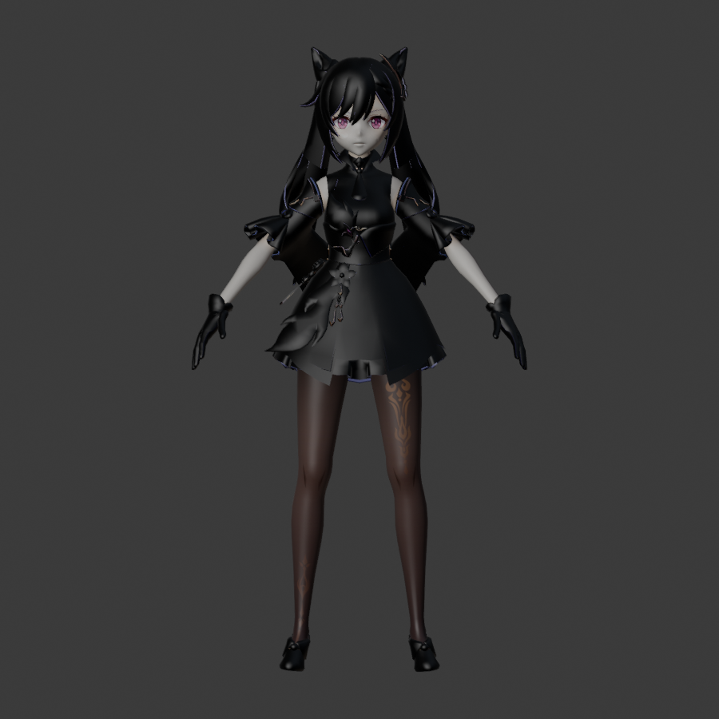

# Keqing Mod for Phantom Blade Zero / 刻晴 Mod · 影之刃零

把《影之刃零》主角「魂」的外观替换为《原神》的刻晴，并把战斗语音换成刻晴语音。

Replace the protagonist **Hun** in *Phantom Blade Zero* with **Keqing** from *Genshin Impact*, including combat voice lines.



## 特性 / Features

| 项目 | 说明 |
|---|---|
| 模型 | 刻晴全身模型，含描边、布料物理、表情与眨眼 |
| 材质 | 借用游戏原生材质实例，覆盖 4 张贴图（D / N / ARM / SCMT）+ 描边贴图 |
| 语音 | 39 个战斗事件（普攻、格挡、受击、破防、处决、呼吸、开大）换成刻晴语音 |
| 保留原声 | 剧情对白、死亡、待机等保持游戏原版 |

- Model: full Keqing mesh with outline, cloth physics, facial animation & blinking
- Materials: reuses the game's native material instances, overrides 4 textures (D/N/ARM/SCMT) + outline
- Voice: 39 combat events replaced with Keqing lines (attack, parry, hurt, break, execute, breath, ult)
- Untouched: story dialogue, death, idle — still the original voice

## 安装 / Install

1. 关闭游戏 / Close the game.
2. 找到游戏 Pak 目录 / Locate the game's pak folder:
   ```
   <steam>\steamapps\common\PBZ\ProjectPBZ\Content\Paks\
   ```
3. 把压缩包里的 `~mods` 文件夹整个复制进去 / Copy the whole `~mods` folder into it:
   ```
   ...\Paks\~mods\zzz_Keqing_P.{pak,utoc,ucas}
   ...\Paks\~mods\zzz_KeqingVoice_P.{pak,utoc,ucas}
   ```
4. 启动游戏 / Launch the game.

## 卸载 / Uninstall

删除 `~mods` 里这 6 个文件即可完全还原。
Delete those 6 files — the game returns to vanilla.

## 已知限制 / Known limits

1. 语音只覆盖 39 个战斗事件，剧情/死亡/待机为原版；
2. 游戏按「事件」触发语音，同一句可能在多个动作重复出现，属引擎机制；
3. 极短槽位保留原声（无法等长写入）；
4. 材质为原生材质实例，外观随场景光照变化；
5. 脸部用「平面法线」处理（二次元平涂感），强侧光下略平；
6. 与其他替换主角外观 / 战斗语音的 mod 冲突，需二选一（把对方文件改扩展名为 `.off` 即可停用）。

## 兼容性 / Compatibility

- 游戏版本：UE 5.7.4（IoStore），2026-11 测试通过
- 与其他 `~mods` 子目录 mod 可共存（GoldenTiger、PBZAdditiveWardrobe 已验证）
- 与 `WuchangVoice` 冲突（同为战斗语音）

## 文件校验 / Checksums

见发布包内 `checksums.txt`（SHA256）。

## 技术说明 / Technical notes

制作流程与踩坑记录见 `docs/TECHNICAL.md`：

- UE5 IoStore 容器手写 v5 ContainerHeader + `retoc pack-raw`
- Wwise bank 等长替换（Vorbis 槽位 `fmt+JUNK+data`、PCM 槽位降采样）
- 必须使用 Wwise 官方编码器（`wav2wem` 编出的 Vorbis 游戏解码为电音）
- 响度统一走 EBU R128 两遍法（−16 LUFS / −1.5 dBTP）

## 许可 / License

代码与打包脚本：MIT。
刻晴角色与语音版权归 miHoYo / HoYoverse 所有；本项目为非商业粉丝作品，仅供个人使用。
影之刃零版权归 S-GAME 所有。

Keqing character and voice © miHoYo / HoYoverse. This is a non-commercial fan project for personal use.
Phantom Blade Zero © S-GAME.
